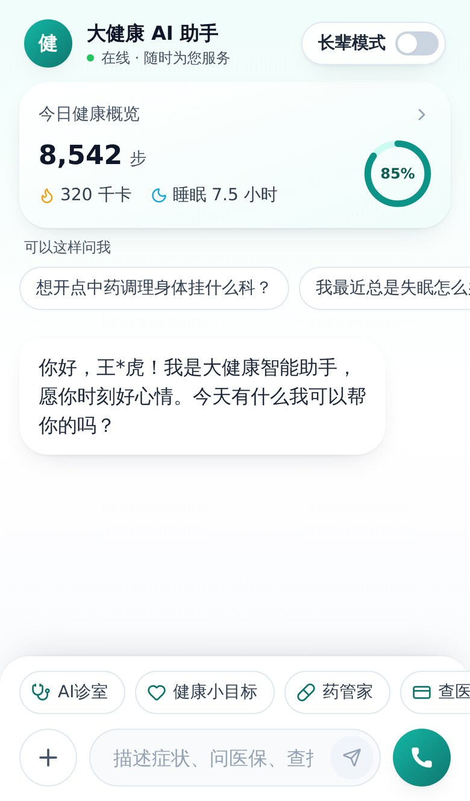
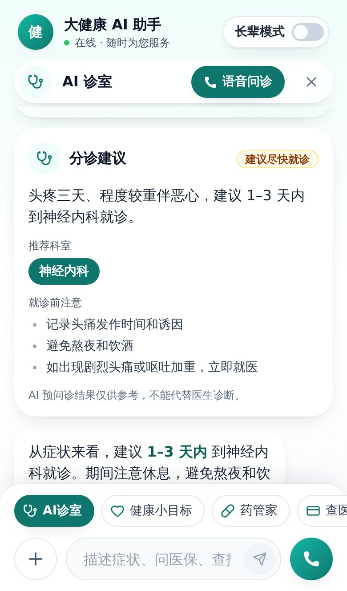
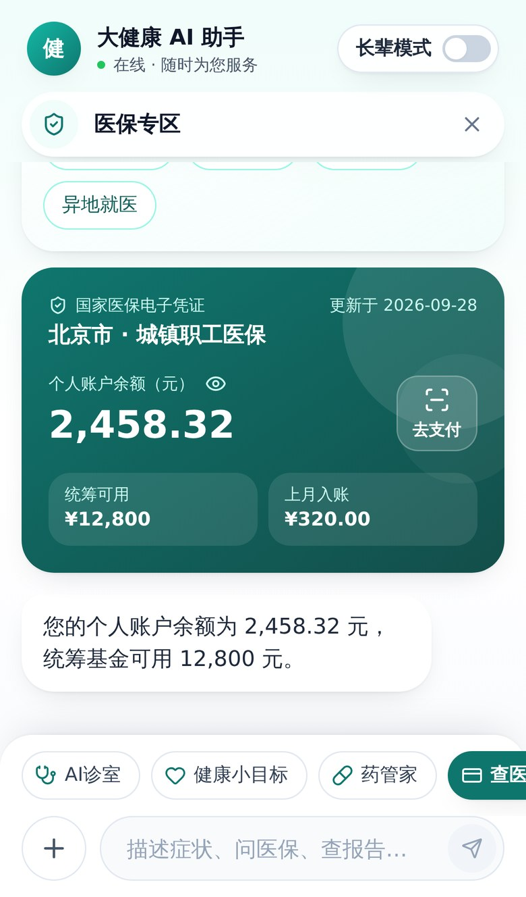
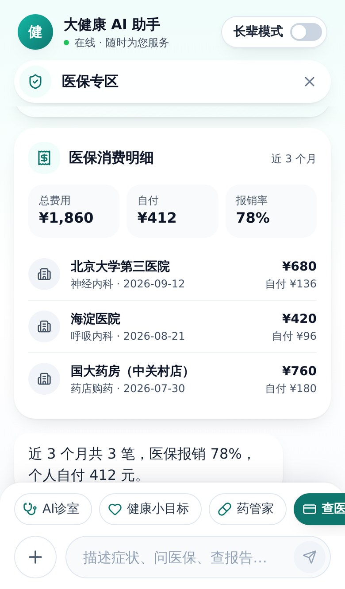
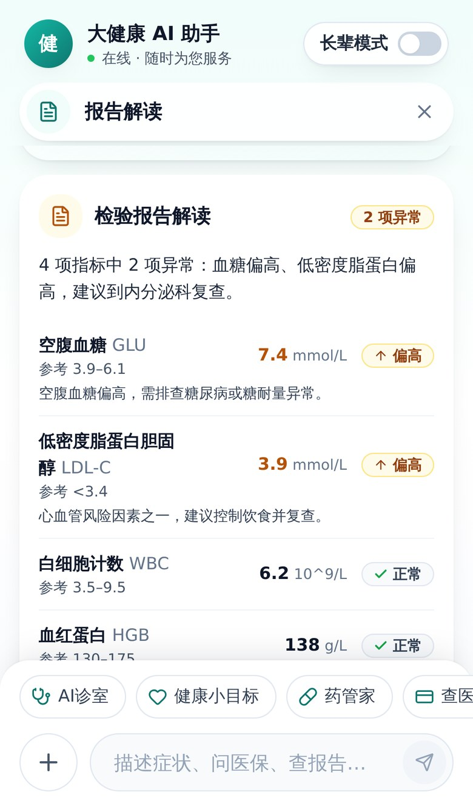
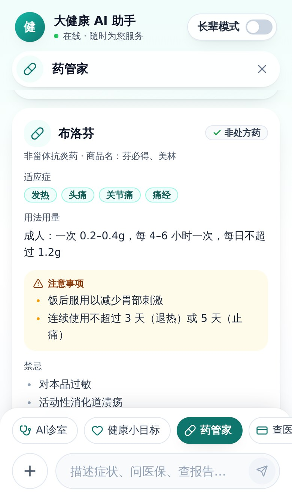
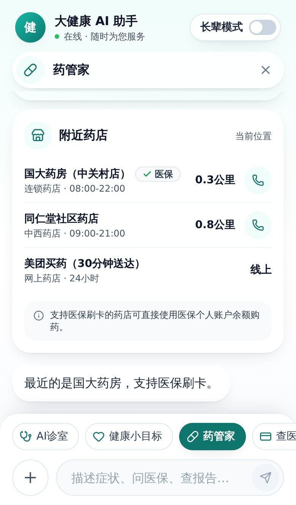
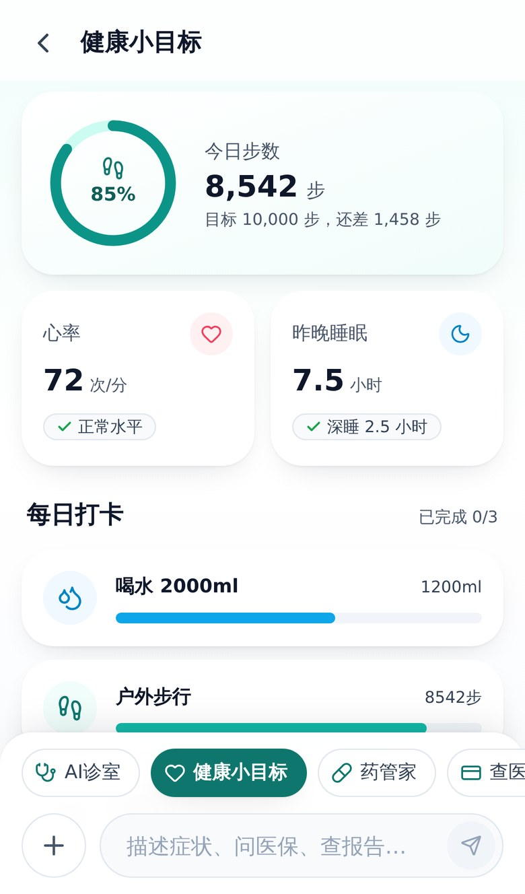
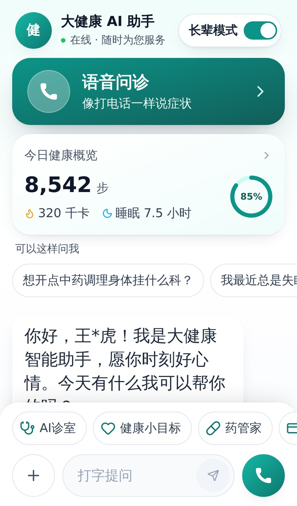

[English](README.en.md) | **简体中文**

# 🏥 MedWeave —— 多智能体医疗助手

> 🚀 **开源版 医疗/医保 多智能体对话系统**

基于 **LangGraph + FastAPI + React** 的完整 AI 多智能体全栈参考实现。不只是一个聊天机器人，而是深度融合了**流式工具调用**、**结构化 UI 卡片**的智能分发引擎。

- 支持 **服务端会话、预问诊子图与 Agent 转接**：Checkpointer + `thread_id`、代码级急症闸门、`interrupt()` 追问、专科之间的 `Command` handoff。详见 [docs/langgraph-runtime.md](docs/langgraph-runtime.md)
- 支持 **问诊暂停与恢复**：追问期间可临时咨询其他专家，再回到同一对话继续问诊；完成后清理活跃状态，保留完整对话历史。
- 支持 **多模态图片识别**：拍照看报告、拍照问药与药品追溯码识别
- 支持 **多模型配置**：聊天模型可切换 ARK、OpenAI、DeepSeek、通义千问、智谱或任意 OpenAI-compatible 服务；图片模型可独立配置
- 支持 **RAG 知识库增强**：常见疾病、医保政策、检验参考范围、药品用药指南。详见 [docs/rag.md](docs/rag.md)
- 支持 **Agent Skills System**：每个智能体可动态加载模块化领域技能。详见 [docs/skills.md](docs/skills.md)
- 支持 **开源可观测与评估**：OpenTelemetry/OpenInference 链路、Jaeger 与 DeepEval 回归评估。详见 [docs/observability-evals.md](docs/observability-evals.md)
- 统一的 **移动端设计规范**：语义色、字号、圆角、阴影全部收敛到设计令牌，长辈模式自动放大。详见 [frontend/docs/design-system.md](frontend/docs/design-system.md)

## 📸 运行效果预览

这是一个 **纯移动端（Mobile-First）** 设计的项目，强烈建议使用 Chrome 手机模拟（iPhone 13 等）体验。截图中的数据均为合成数据。

<table>
  <tr>
    <td align="center"><br/><b>1. 首页：健康概览 + 对话</b></td>
    <td align="center"><br/><b>2. AI 诊室：分诊建议卡片</b></td>
    <td align="center"><br/><b>3. 医保电子凭证与余额</b></td>
  </tr>
  <tr>
    <td align="center"><br/><b>4. 医保消费明细</b></td>
    <td align="center"><br/><b>5. 检验报告逐项解读</b></td>
    <td align="center"><br/><b>6. 药品信息与用药提醒</b></td>
  </tr>
  <tr>
    <td align="center"><br/><b>7. 附近药店（医保 / 一键拨打）</b></td>
    <td align="center"><br/><b>8. 健康小目标</b></td>
    <td align="center"><br/><b>9. 长辈模式</b></td>
  </tr>
</table>

---

## ✨ 核心特性

- **🧠 多智能体路由 (Multi-Agent Routing)**:
  - 采用总分架构。通过全局 Router Agent 实时进行意图分类，无缝调度至不同的垂直领域专家智能体。
  - **支持预问诊** (Clinic Agent)：多轮追问症状（部位、持续时间、伴随症状等），最终生成带紧急程度的就诊科室建议卡片。
  - **支持医保服务** (Insurance Agent)：接入模拟医保接口，查询医保余额、消费明细、缴费记录、异地就医备案，数据通过卡片直出。
  - **支持健康问答** (Advisor Agent)：通用的医学科普与生活建议。
  - **支持药管家与报告解读**：药品信息、相互作用查询、附近药店、拍照问药，以及检查报告图片和检验指标逐项解读。

- **🔁 服务端会话与 Agent 转接 (Checkpointer + Handoff)**:
  - 主图携带 LangGraph Checkpointer（memory / sqlite），会话按 `thread_id` 持久化，前端每轮只发最新一条消息。
  - 预问诊是独立子图：代码级急症闸门先于任何模型调用，并且每次追问的回答都会重新经过闸门；一次结构化调用同时完成症状抽取与追问起草；信息不足时用 `interrupt()` 挂起追问，用户回复后从断点恢复。
  - 专科之间支持 swarm 式转接：在医保模式里描述症状，医保智能体会通过 `transfer_to_clinic` 把这一轮直接交给预问诊，不再需要用户先说“退出”。

- **⚡ 丝滑的 UI 端到端体验 (SSE + Server-Driven UI)**:
  - **后端接管 UI 渲染**：工具调用完成后，后端不仅返回文字总结，还通过 SSE 下发 `{"type": "card", "payload": ...}` 事件。
  - **前端动态呈现**：所有结果卡片基于共享的 `ResultCard` 组件族，异常、待确认、急症用统一的语义色区分。

- **👵 适老化无障碍设计 (Elder-Friendly Mode)**:
  - 一键切换长辈模式：全局字号上移一级，主按钮与关键操作入口同步放大。

- **📚 RAG 知识库增强 (Retrieval-Augmented Generation)**:
  - 内置混合检索引擎：**BM25（精确匹配）+ 密集向量（语义检索）**，通过倒数排名融合（RRF）合并结果，精准命中医学术语的同时兼顾语义理解。
  - 覆盖四大领域知识库：**常见疾病（高血压/糖尿病/心脏病）、医保政策（门诊/住院报销/异地就医）、检验参考范围（血常规/生化/尿常规）、药品用药指南（OTC/处方药/药物相互作用）**。
  - **可插拔后端设计**：嵌入模型支持 HuggingFace 本地（`BAAI/bge-small-zh-v1.5`，离线可用）、OpenAI API、字节 ARK API 三选一；向量库支持 Chroma / FAISS / Qdrant / pgvector 按需切换。服务启动时后台预热，首次检索不再等待模型加载。

- **🧩 可插拔技能系统 (Agent Skills System)**:
  - 每个智能体均可动态加载**模块化领域技能**，无需修改 Agent 代码即可扩展能力。
  - 内置 6 项核心技能：急症安全预检（`emergency_triage`）、症状严重度评分（`symptom_scorer`）、健康指标计算（`health_calculator`）、化验单解读（`lab_interpreter`）、慢性病风险评估（`risk_assessor`）、药物剂量计算（`medication_calculator`）。
  - **零配置自发现**：新增技能只需创建子目录 + `SKILL.md` + `skill.py`，工具参数直接取自技能的 `input_schema`；单个技能加载失败只会跳过它本身。

- **🔭 开源可观测与评估 (Observability & Evals)**:
  - 使用 OpenInference 自动采集 LangGraph 节点、文本/视觉模型与工具调用，以标准 OTLP 输出到 Jaeger 或其他 OpenTelemetry 后端。
  - 内置匿名回归样例与严格本地评分，可选 DeepEval；医疗文本和图片默认不进入 Trace，DeepEval 遥测默认关闭。

- **🛠️ 完整全栈工程实现**:
  - **Backend**: Python、FastAPI、LangChain、LangGraph、Uvicorn，遵循严格的类型提示和清晰的状态流转（State Graph）。
  - **Frontend**: React、TypeScript、TailwindCSS、Vite，基于设计令牌的移动端界面。

---

## 🚀 快速开始

本项目分为前端（React + TypeScript）和后端（Python FastAPI）两部分。

先克隆项目（私有仓库需要具有访问权限的 GitHub 账号）：

```bash
git clone https://github.com/Wula112/MedWeave.git
cd MedWeave
```

### 1. 后端服务 (Backend)

后端以 Python 编写，推荐使用 `uv` 进行环境管理。

```bash
cd backend

# 安装依赖项
uv sync

# 配置环境变量
cp .env.example .env
# 在 .env 中配置模型厂商、API Key 与模型名称，支持多家 OpenAI-compatible 服务

# 【首次运行】构建 RAG 知识库向量索引
# 默认使用本地 HuggingFace 嵌入模型，首次运行会自动下载约 90 MB 的模型文件
uv run python -m rag.ingest

# 启动服务 (运行于 8000 端口)
uv run uvicorn main:app --reload --port 8000
```

多 Worker 部署使用 `uv run uvicorn main:app --workers 2 --port 8000`。
API 默认使用共享 SQLite checkpoint 与 Run 存储，同一主机的全部 Worker
必须使用同一数据目录；详见 [Agent Runtime 执行控制与部署](docs/agent-runtime.md)。跨会话记忆提取配置见 [Mem0 记忆提取](docs/mem0-memory.md)。

### 2. 前端服务 (Frontend)

```bash
cd frontend

# 安装依赖
npm install

# 启动开发服务器 (运行于 5173 端口)
npm run dev
```

启动完成后，在浏览器中访问 http://localhost:5173。切换设备模拟为手机视图（iPhone 13 等）以获得最佳体感。

---

## 📜 规划与 Roadmap

- [x] 多 Agent 路由调度核心 (LangGraph)
- [x] 智能预问诊 & 报告科室推荐
- [x] 基于流式卡片的医保服务面板 (对齐真实业务场景)
- [x] 上下文环境隔离机制 (进入专科诊室 / 退出诊断) + Agent 之间的 `Command` 转接（swarm 式 handoff，跑错专科可同轮纠正）
- [x] RAG 知识库增强：混合检索（BM25 + 密集向量）+ 可插拔嵌入模型与向量库
- [x] 药管家 Agent（Pharmacy Agent）：药品查询、药物相互作用、OTC 推荐、附近药店
- [x] 可插拔技能系统（Agent Skills）：6 项核心技能 + 零配置自发现注册表
- [x] 多模态图片识别：拍照看报告、拍照问药与药品追溯码识别（可配置兼容模型）
- [x] Agent 生命周期基础设施：OpenTelemetry/OpenInference 链路、Jaeger 与 DeepEval 回归评估
- [x] 服务端会话状态：LangGraph Checkpointer + `thread_id`，支持 memory / sqlite 两种后端
- [x] 预问诊子图：代码级急症闸门、结构化症状抽取与 `interrupt()` 追问恢复
- [x] 卡片归属权下沉：由各 Agent 自行推送 SSE 卡片，API 层不再维护「工具名 → 卡片类型」映射
- [x] 移动端设计规范：设计令牌 + 共享卡片组件 + 长辈模式字号体系

## 📄 开源协议

本项目采用 **MIT License**。你可以自由使用、修改和分发，但也请在你的项目中保留本项目的署名。

## 💡 鸣谢与灵感

本项目产品交互灵感来源于对**医疗大健康赛道**真实落地诉求的拆解，特别致敬业内优秀产品在“长辈模式”、“卡片富文本协同”领域的探索与实践。期待与开源社区一起，将这一套生产力框架推广到更多垂直泛健康场景。
