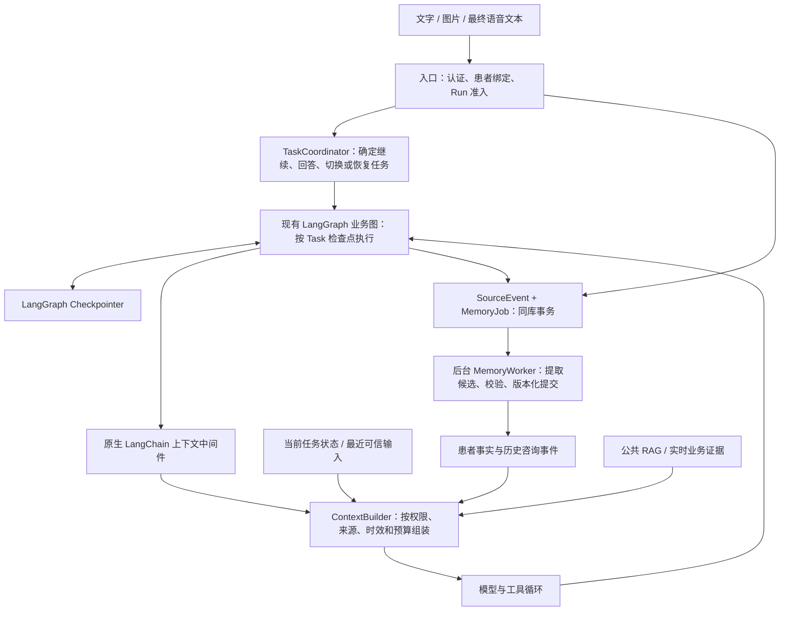

# Smart Health：上下文与患者长期记忆设计

> 后续调整（2026-11-01）：项目已实现问诊中途切换与恢复，当前不引入 Task；首版长期记忆使用 Mem0 Platform。实际接入和运行边界见 [Mem0 记忆提取](mem0-memory.md)。本文保留为早期设计参考。

状态：设计建议，尚未实施。基于 2026-10-31 的本地项目源码、三份用户提供的建议，以及文末的官方资料。

## 1. 推荐结论与首版范围

采用“统一上下文组装 + 独立任务检查点 + 患者级事实记录 + 可靠异步提取”。

会话和任务保证当前工作能继续；长期记忆补充跨会话背景；正式报告、处方和医保数据由业务服务负责。四者可以共同参与一次回答，但职责和证据地位不同。

核心取舍：

| 问题 | 建议 |
|---|---|
| 如何借鉴 DeerFlow | 复用检查点、摘要、来源标记、中间件组装、增量提取与后端接口分离的思想 |
| 患者事实是否按 Agent 分桶 | 以患者为主键统一保存，按专家职责和访问权限生成不同视图；`source_agent` 只记录产生来源 |
| 如何借鉴 Mem0 | 借鉴事实抽取、关联检索和可替换后端；医疗状态、证据验证和冲突处理由应用控制 |
| 是否立即引入 Mem0、Redis、RabbitMQ | 首版延续同机多 Worker 和 SQLite，增加数据库任务表；后续按实际检索和吞吐需求替换 |
| 是否直接使用通用对话摘要 | 增加医疗状态保护；摘要只负责衔接语言上下文，不承担唯一病情记录 |
| 是否让模型自行增删病史 | 模型只提出候选；应用校验来源、患者、状态与变更权限后写入 |
| 是否保存所有对话为永久画像 | 仅在长期记忆授权范围内保存有跨会话价值的信息；普通问答和临时症状不自动成为长期患者状态 |

这是一套医疗信息管理设计，不等同于经临床验证的诊断或用药决策系统。工程验收要与临床规则验证分开。

## 2. 当前项目已有的基础与真实缺口

| 当前实现 | 对设计的影响 |
|---|---|
| `MainAgentState.messages` 使用 `operator.add` 追加历史 | 服务端会累计消息；请求入口的 `[-10:]` 不等于已保存历史始终只有十条，当前没有完整的上下文预算机制 |
| `ClinicState` 已有 `collected`、`pending_question`、追问次数、复述确认和 `interrupt()` | 应继续利用这些结构化状态，避免另建一套依赖语义检索的问诊进度 |
| 有 pending interrupt 时，入口直接 `Command(resume=user_text)` | “先查医保再继续问诊”不能只改 Router；新消息目前会先被当作问诊回答 |
| Router 对 `active_agent` 短路，专家依靠 handoff 转接 | 新方案需要在恢复图之前确定 Task；同一 Task 内仍可复用现有 handoff |
| `exitChatMode()` 清空前端 `threadId` | 退出专家模式、结束任务、创建新会话需要成为三个明确操作 |
| `UserInfo` 没有认证主体和患者标识，`medical_history` 默认是“无” | 不能据此实现跨用户长期记忆；缺失病史必须表示“未知/未提供”，不能当作明确否认 |
| 专家各自拼接 `user_info` 和 RAG 内容，再读取共享历史 | 应统一上下文选择与来源标记，避免专家看到无关信息或不同版本的病史 |
| 图片识别文本被包装成 `HumanMessage` 再传给专家 | 必须标明“上传文档/OCR 派生数据”，不能把这类消息误判为患者亲口陈述或已核实报告 |
| 医保工具使用 `_MOCK_*` 数据 | 模拟业务结果不能变成患者真实财务记录或经过核实的医疗证据 |
| 已有共享 SQLite、Run 准入、租约、取消、异常收尾和原生 LangChain 中间件工厂 | 可以增量接入，首版无需更换整个执行框架 |

当前代码未接入 Redis/RabbitMQ 长期记忆流水线。已有的 PostgreSQL 向量库适配器是 RAG 的可选后端，不代表已经有患者业务数据库。

## 3. 信息分层：四种用途，共用受控的组装入口

| 信息层 | 保存内容 | 权威来源/保存位置 | 使用方式 |
|---|---|---|---|
| 会话上下文 | 当前 Thread 的消息引用、最近对话、带来源的会话摘要 | 服务端消息记录、Thread 元数据 | 支持指代和话题衔接 |
| 任务工作状态 | 当前症状、明确否定、未问字段、待回答问题、报告引用、任务状态 | Task 对应的 LangGraph checkpoint | 确定性恢复当前任务 |
| 跨会话记忆 | 沟通偏好、带来源的病史/过敏/用药陈述、历史咨询事件 | PatientMemoryStore | 基础信息直接查询，其他信息按需检索 |
| 业务证据 | 原始报告、结构化检验值、处方、医保接口结果 | 业务数据库、受控文件服务或外部接口 | 按权限获取，并附来源与时间 |

`RunContext` 仍只管理一次执行的 deadline、缓存、资源和执行引用；它不是长期病历。公开医学知识 RAG 与患者私人记忆也要分开存储、分开授权和检索。



## 4. 身份、Thread、Task 与 Run

### 4.1 身份以患者为中心

- `account_id`：谁在使用系统，由服务端认证产生。
- `patient_id`：这次咨询的是谁；同一账号可能代父母或孩子咨询。
- `thread_id`：用户可见的聊天会话，首版固定绑定一个患者。
- `task_id`：一次具体业务目标，属于该 Thread。
- `run_id`：当前请求的一次受控执行，延续现有 Runtime 定义。

先确认账号对患者及 Thread 的访问权，再读取 checkpoint、记忆和业务数据。`user_info`、前端上传的 patient_id、姓名及模型识别结果均不能单独授权访问。

“我爸爸有糖尿病”不得记到当前用户本人名下。不能确定是在说谁时，可暂留本次输入供澄清，但不得提升为某位患者的长期事实。语言和界面偏好可归账号；病史与用药必须归患者。

本地演示可以显式使用一个本地患者身份；真实多用户长期记忆应在身份及访问控制完成后开放。现有语音同意不能自动当作跨会话医疗记忆的授权。

### 4.2 每个 Task 使用独立的物理检查点标识

```text
用户可见 Thread C1，患者 P1
├── Task T1：预问诊       checkpoint_thread_id = K1，等待回答
├── Task T2：医保查询     checkpoint_thread_id = K2，完成
└── Task T3：报告解读     checkpoint_thread_id = K3，进行中
```

`configurable.thread_id` 使用 K1/K2/K3；API 的 `thread_id` 仍表示 C1。两种标识显式映射，避免把显示会话和图执行状态混为一谈。

Task 不等于 Agent。围绕同一业务目标从 Clinic 交给 Pharmacy，可以继续同一个 Task；独立的医保查询、新报告解读或新的症状事件才需要新 Task。已完成任务的后续独立问题可以新建关联任务。

首版 Task 归属固定 Thread。“继续昨天的问诊”应定位到经授权的原会话，或新建关联任务并核对当前情况；不自动把一个正在等待的 Task 同时挂到多个会话执行。

Task 可以长期处于 `waiting_input`；产生追问的 Run 则结束为现有的 `waiting_input` 终态并释放执行名额。用户回答时创建新 Run，选择 Task 后再恢复对应检查点。

### 4.3 在 `Command(resume=...)` 之前决定输入用途

入口的任务协调步骤接收：最新输入、当前 Task 状态、待回答问题、最近少量相关对话及可恢复任务列表。

可返回受校验的动作：

| 动作 | 行为 |
|---|---|
| `answer_pending` | 只有确认这是当前问题的回答时，才恢复对应 Task 的 interrupt |
| `continue_task` / `handoff` | 继续当前目标；必要时由现有 handoff 转交专家 |
| `new_task` | 创建独立任务；旧任务保留 checkpoint 和待回答问题 |
| `resume_task` | 校验任务归属后恢复指定 Task，必要时先核对时效 |
| `finish_task` | 显式结束当前任务，保留会话和历史记录 |
| `clarify` | 意图或患者不明确时先澄清，不把输入写进错误槽位 |

优先使用明确的 UI 动作和服务端规则，语义路由只负责提出选择，任务 ID 与状态由应用验证。每条新的临床陈述仍需进入适用的安全分流，不能因为在查医保或已经有历史摘要就跳过。

Run 准入仍按 C1 串行，确保同一会话一次只有一个写入者。清理与恢复必须使用该 Run 实际操作的 K1，而不是误用 C1。当前 `RunContext.thread_id`、`_cleanup_thread` 和 checkpoint 访问接口需要在接入时明确区分这两个引用。

## 5. 医疗记忆的数据语义

### 5.1 先做三类记录，不引入复杂知识图谱

1. **Profile/Preference**：语言、表达方式等偏好；患者年龄须带记录日期，或从已有且获准使用的出生日期推导。
2. **ClinicalStatement**：患者自述或业务证据支持的病史、过敏、用药等独立陈述。
3. **ConsultationEvent**：某时因何问题咨询、有哪些已记录事实、系统给过什么分诊建议，以及建议是否有后续反馈。

AI 完成一次预问诊，只能记录“完成预问诊/给出分诊建议”；不能生成“患者已到医院就诊”或“已确诊”的事件。短期症状可以进入带日期的咨询事件，但不直接转成永久疾病标签。

患者画像由结构化事实投影生成，避免再独立维护一份不断改写、难以追溯的自由文本“权威病史摘要”。

### 5.2 必须分开的字段

| 维度 | 字段示例 | 解释 |
|---|---|---|
| 归属 | `account_id / patient_id / domain` | 谁的资料、哪个领域 |
| 语义 | `kind / predicate / value / assertion` | 是什么；肯定、否定还是不确定 |
| 来源 | `source_kind / source_refs / reported_by` | 患者自述、最终 ASR、上传报告 OCR、可信业务接口等；引用具体消息或文档位置 |
| 核实 | `verification_status` | 未核实、经有权主体核实、被否定等 |
| 记录生命周期 | `record_status / supersedes / version` | 候选、已接纳、争议、被替代、撤回等 |
| 临床状态 | 按领域定义的状态 | 例如用药是否仍在使用；不能与“记录已接纳”混用 |
| 时间 | `event_time / recorded_at / valid_from / valid_to / original_time_text` | 事件何时发生、何时获知、适用区间，以及原话 |
| 复核与派生 | `last_reviewed_at / review_after / derived_from / extractor_version` | 何时需复核、哪些来源支撑了当前记录 |

`extraction_confidence` 如需保存，只表示模型对抽取的自估，不是临床可信度，也不能作为自动升级“已确诊”的阈值。

参考 FHIR 将临床状态与核实状态分开的语义，但首版无需实现完整 FHIR Server。FHIR Condition 与 AllergyIntolerance 都明确区分这两个维度。[Condition R4](https://hl7.org/fhir/R4/condition.html)、[AllergyIntolerance R4](https://hl7.org/fhir/R4/allergyintolerance.html)

例如“小时候打青霉素起过疹子，医生说可能过敏”，可形成：

```json
{
  "patient_id": "patient_demo",
  "kind": "allergy_statement",
  "substance": "青霉素",
  "assertion": "suspected",
  "source_kind": "patient_report",
  "verification_status": "unconfirmed",
  "record_status": "accepted",
  "original_time_text": "小时候",
  "event_time": null,
  "source_refs": [{"message_id": "message_demo"}],
  "version": 1
}
```

这里接纳的是“患者曾这样陈述”，没有证明患者确有该过敏。它仍可作为需核对的用药风险背景，不能因未核实而在相关咨询中完全隐藏。

### 5.3 当前任务使用显式状态，不能用空值代替临床含义

症状观察至少区分 `present / absent / uncertain / not_asked`，并附患者、时间、消息来源。问过但无法确认时可另记 `unknown`，不要假装已排除。

当前 `_merge_facts` 忽略空字符串和空数组，无法表达“之前说有，现在明确更正没有”或主动清空错误字段。需要显式的槽位更新操作，例如 `set / deny / clear / correct`，保留变更来源。

“这次无胸痛”仅属于本次任务及对应时间，不自动用于下一次胸部不适。“未提供既往史”也不能继续沿用 `medical_history="无"` 的默认语义。

语音“对”的确认要绑定具体问题、展示过的槽位和 Task 版本；这确认患者同意了这段复述，不构成医生核实。ASR 的药名、剂量或否定词不明确时先复述核对。

## 6. 上下文如何选择、刷新与注入

### 6.1 读取顺序

1. 验证账号、患者、Thread 和 Task 的归属与授权状态。
2. 读取当前 Task 的结构化状态及最新可信输入。
3. 在适用的临床咨询中，直接查询相关过敏/风险提示及待核实的最新变更，不能只依赖向量相似度。
4. 读取相关病史和最后获知的用药状态；需要时查询正式业务记录或再次核对。
5. 按任务、实体和时间检索其他咨询事件，必要时再增加语义检索。
6. 加入最近完整对话、对应摘要与公共知识证据，执行总 token 预算。

权限、患者、删除状态和适用时间是硬过滤条件；向量相似度、关键词和新近程度只用于相关性排序。相似度高不代表事实更可靠。

### 6.2 专家看到不同视图

| 调用方 | 默认上下文 | 按需追加 |
|---|---|---|
| Router/TaskCoordinator | 最新输入、Task 列表与状态、待回答问题、少量相关对话 | 用于消除任务歧义的描述 |
| Clinic | 当前症状与明确否定、待问字段、相关风险背景 | 相关病史、最后获知用药、报告与历史咨询 |
| Pharmacy | 当前药物问题、相关过敏/用药变更、必要健康背景 | 药品和相互作用服务、适用的报告证据 |
| Report | 当前报告的时间、数值、单位、参考区间和来源 | 同一指标且可比较的历史记录、相关病史 |
| Advisor | 当前问题、相关健康背景与表达偏好 | 与当前问题有关的问诊建议或事件 |
| Insurance | 当前查询/办理意图与必要身份、地区、业务参数 | 本次授权范围内的业务接口数据 |

医保政策判断确需某项疾病或资格材料时，应按具体用途获取必要证明；不默认给 Insurance 整份病史。所有专家读取视图都由服务端策略限定，不能只靠提示词让模型“自觉少看”。

### 6.3 更新策略与指令边界

每次 Run 开始读取当前记忆版本；同一次 Run 内可缓存。每次模型调用及相关工具执行前检查授权/撤回版本，版本变化就重新组装；任务阶段变化时重新选择相关事实。

长期事实的读取不固定在 Thread 第一次消息。这样已打开的会话也能反映停药纠正、记忆撤回和新确认的信息。这个选择优先保证医疗信息新鲜度，接受部分提示前缀缓存收益的损失。

记忆与 OCR/RAG 内容作为有来源的外部数据注入，不能直接拼成可修改角色或权限的系统规则。静态系统提示负责角色与医疗边界，动态数据负责事实背景。采用服务端生成的来源标记，忽略客户端伪造的“已核实”“系统记忆”等元数据。

消息和事实来源由服务端记录。客户端传回的完整历史不作为新的医疗证据反复接纳；无法验证的旧助手回复不能通过历史回灌升级为患者档案。

上下文投影只进入本次 `ModelRequest`，不把检索到的旧记忆追加为新的患者消息，也不把它再次送入长期提取。

## 7. 长对话压缩：保护医疗状态与完整调用关系

### 7.1 预算按最终请求计算

```text
可用输入预算 = min(应用输入上限, 模型窗口 - 输出预留 - 安全余量)
```

需要计算静态系统提示、工具 schema、动态事实、摘要、对话与 RAG，而非只数消息条数。模型窗口需依据实际接入配置确定，不能直接照搬 DeerFlow 的 token 阈值。

可先把“输入达到可用预算的约 75% 时准备压缩、压缩到约 55%～60%”作为工程试验参数；长期事实注入可先设约 1000～1500 token 的普通预算。这些数值需要以中文问诊、工具 schema 和语音时延的回归结果校准，不是医学阈值。关键状态如果不能容纳，应减少非必要资料或缩小任务，不能悄悄丢弃。

保留优先级：

1. 当前真实问题、患者归属和固定安全规则。
2. 当前任务症状、明确否定/不确定、风险提示、未解决冲突与待回答问题。
3. 当前完整模型工具调用周期及相关业务证据。
4. 最近若干轮完整对话。
5. 相关旧消息的摘要、历史记忆和可选知识片段。

既往的症状或红旗只能带时间引用，不能直接渲染成“当前存在”。所有 AI tool_calls 与对应 ToolMessage 成组保留或成组压缩；不在调用尚未配对时裁掉半组。

### 7.2 摘要如何生成

先从结构化状态确定任务事实，再将可压缩的旧对话整理成：主题、已做事项、未完成事项、重要纠正及来源引用。关键症状、否定和药物信息仍从结构化字段读取；摘要不能创造新的医学事实。

摘要携带覆盖的 source 序号/ID、患者、Task、生成版本和引用。长期偏好/患者档案不是本次任务摘要的一部分。对过长 ToolMessage 优先保留已验证的结构化结果与原始记录引用，避免反复传入大段文本或图像编码。

首版优先做**模型请求投影压缩**：保存原始证据，在中间件中选择本次输入和摘要。先不直接删除父图历史。原因是当前父图使用 `operator.add`，专家又通过输入消息数量切出新输出；直接在内层套用会改写消息列表的通用摘要中间件，可能破坏这些契约，也不能自动压缩父图 State。

后续若需减少 checkpoint 体积，再迁移到支持按消息 ID 更新/移除的 reducer，并一并修改专家输出切片、handoff 和中断恢复测试。图工作状态的裁窗只能在来源已可靠保存、摘要成功并可追溯之后提交。LangChain 官方也将 trim、delete 和 summarize 作为有不同状态影响的处理方式。[短期记忆](https://docs.langchain.com/oss/python/langchain/short-term-memory)

摘要失败时保留原始来源和结构化状态；若必要内容仍无法放入模型窗口，应明确缩小任务或返回可恢复的上下文预算错误。

## 8. 长期记忆的提取与可靠写入

### 8.1 可用的证据

| 来源 | 策略 |
|---|---|
| 经身份绑定的患者输入 | 可提出长期候选，保留自述属性与对应消息 |
| 最终 ASR 文本 | 标明语音来源；关键歧义先核对，临时 partial 不参与提取 |
| 用户对具体问题的确认或纠正 | 绑定问题、槽位、Task 版本后应用，不能一律过滤掉“对/是” |
| 经过领域适配器校验的业务记录 | 允许保留最小事实与引用；模拟数据明确排除 |
| OCR 结果 | 保留文档来源和未核实状态，不自动当作确诊或医院认证数据 |
| 助手答复 | 可以用于理解问答关系，但不能单独证明患者有某疾病、已服药或已就医 |
| 注入记忆、摘要、RAG、工具推测、内部推理 | 不作为新的患者陈述再次学习 |

“如果我对青霉素过敏怎么办”是条件提问，不是已存在过敏；“医生怀疑”不能变成“确诊”。模型只返回有源引用的结构化候选，由应用执行这些门控。

### 8.2 同步完成必要事实交接，后台提取长期资料

同步链路负责身份、原始有效输入、任务槽位及明确纠正。结构化输入或明确识别的新增过敏/停药等变更，先落为有来源的待核实更新或状态变更标记；含糊内容保留原话，不猜测新状态。

下一位专家必须看见这些尚未完成长期提取的最新变更。不能因为后台排队，就继续把旧用药记忆当作当前确定状态。待处理更新无法解释时先核对，不输出依赖旧状态的个体化用药建议。

后台提取只读取未处理的 source 增量，合并短时间内的输入。没有新证据的轮次不重复调用提取模型；不能靠“一个简单关键词没有命中”直接跳过可能的重要临床陈述。

用户原话可以在 Run 失败后仍是有效的自述来源；“完成分诊/生成有效报告结论”等事件必须有对应成功任务及已提交记录。不能只看是否收到 SSE `finish`，也不能只用助手最后一句话推断任务完成。

### 8.3 同机多 Worker 的后台任务

```text
持久化 SourceEvent / 已提交任务证据
        + 同事务创建 MemoryJob
                    ↓
MemoryWorker 短事务领取（租约）
                    ↓
事务外调用提取模型
                    ↓
校验来源、授权、删除版本、当前患者事实版本
                    ↓
同事务提交记忆变更 + 提取水位 + Job 完成状态
```

首版可以用 `.runtime/memory.sqlite3` 中的持久任务表直接领取，不需要 RabbitMQ。每条任务和候选有稳定幂等标识；唯一键覆盖源事件及候选身份。以患者事实版本做 CAS，避免不同 Thread 同时修改同一患者时相互覆盖。数据库写事务不能跨越 LLM 网络调用。

队列重投是“至少一次处理、幂等应用”；不能承诺模型只调用一次或任意外部系统恰好执行一次。失败有限次重试后进入可观察的失败状态，不提前推进提取水位。后台任务使用独立 deadline 与资源上下文，不继承已经结束的前台 Run 时限和工具缓存。

**跨数据库的一致性边界要明确。** 现有 checkpoint、Run 元数据与新增记忆库是不同连接/文件，不具备共同事务。上述 outbox 只保证 SourceEvent 和 MemoryJob 同库原子，不保证它们与 LangGraph checkpoint 一起提交。

接入时需要记录 Task 的执行引用、checkpoint ID/版本与已捕获水位；对账器扫描未完成捕获的提交，补建事件。只能从可验证的已提交状态恢复，结果不明时保留待核对，不虚构完成事件。初始原话已提前持久化，摘要不应成为未被保存事实的唯一来源。

借鉴 DeerFlow 的压缩前 flush，但这里在压缩前确认的是“来源已持久保存，提取任务可恢复”，不是等待后台 LLM 已经完成长期记忆写入。

## 9. 纠正、时效、冲突与遗忘

### 9.1 不使用统一的“新消息覆盖旧事实”

| 场景 | 处理 |
|---|---|
| “我更喜欢简短回答” | 替代旧偏好，保留变更版本 |
| “医生昨天让我停药了” | 记录新的停药自述及原话时间；旧“正在服用”不再无条件当作当前状态，保留历史及待核实状态 |
| 已有过敏记录，用户说“现在不过敏了” | 形成待解决冲突/复核，不仅按时间新旧删除既往风险记录 |
| “刚才说三天，其实五天” | 更新当前 Task 的相应槽位，保留本次更正来源 |
| “上次不胸痛，这次有胸痛” | 新任务或新时段的观察；不能用历史否定压掉本次输入 |
| “忘掉这条资料” | 按隐私撤回处理，不把撤回解释成医学上“否定/已恢复正常” |

病史、疑似过敏与用药变更应保留相互独立的证据。语义近似仅用于找候选重复项，不能把剂量、时间、主体或否定状态不同的记录自动合并。对账和变更策略按领域编写，LLM 自估置信度不决定证据优先级。

药名归一化应使用接入的药品字典或经校验的映射；无法确定时保留原文并澄清，不让提取模型编造药品编码。

### 9.2 有效性与存储期限分开

- 过敏与重要病史：持续保留来源，按需复核，不因低频访问、统一 90 天阈值或普通容量淘汰自动消失。
- 用药、妊娠及近期症状等动态信息：展示“最后一次获知时间”，在相关建议前重新核对；不凭过去使用记录推定一直服用。
- 症状否定：绑定任务和观察时间，新的症状事件默认重新评估。
- 检验值：保留采样/报告时间、单位、参考区间与原文，不凭文字摘要推导疾病诊断。
- 医保余额及办理进度：以本次接口查询为准；模拟接口不提供真实状态保证。

`review_after` 表示需要复核，不表示到期变成“无病/无过敏”。数据是否继续保存另由授权与保留策略决定。

### 9.3 遗忘要覆盖派生链

撤回后更新患者记忆/授权版本，阻止新注入；同时处理事实记录、检索索引、运行缓存、摘要与来源的再次提取资格。后台 Job 提交前必须重新校验撤回版本，防止旧任务把资料写回来。

如果原对话仍保存该陈述，未来组装输入和重新生成摘要时也必须按来源屏蔽；只删除一行长期 Fact 不足以实现“以后别再使用”。无法精确分离的旧摘要应整体失效并重建。当前 Task 中依赖该来源的状态也应失效或重新询问，而不是被当作阴性信息。

“撤回长期记忆”与“删除原始聊天/报告”是不同操作，界面应说明范围。已经发出的模型请求无法收回其已传输内容；撤回可以停止后续使用，并中止受影响运行以避免继续沿用旧上下文。

## 10. 建议代码组织和接入方式

```text
backend/
├── context/
│   ├── schemas.py          # TaskView、ContextFrame、带来源的观察与摘要
│   ├── tasks.py            # Task 协调、物理 checkpoint 映射与恢复校验
│   ├── builder.py          # 为不同角色构造请求上下文
│   ├── policy.py           # 领域可见性、时效与优先级
│   └── compaction.py       # token 预算、摘要与来源覆盖校验
├── memory/
│   ├── schemas.py          # 事实、事件、来源、生命周期
│   ├── service.py          # 查询、确认、纠正、撤回的应用入口
│   ├── policy.py           # 可提取来源与医疗变更门控
│   ├── store.py            # 首版 SQLite：元数据、来源、记忆、持久 Job
│   └── worker.py           # 增量提取、幂等、版本化应用与对账
└── agents/middlewares/
    ├── clinical_context.py
    └── context_budget.py
```

这是职责划分，不要求首版为每个概念再创建一层 Manager。`ContextBuilder` 负责组合视图；`PatientMemoryService` 负责事实生命周期；Task 与业务数据各守自己的边界。

核心持久数据可围绕 `thread`、`task`、`source_event`、`patient_memory`、`memory_job`、`memory_scope` 组织。Thread/Task 保存带来源的摘要元数据；Task 的可恢复图工作状态以 checkpoint 为准，任务表保存定位与生命周期信息，不再独立维护另一套可任意修改的症状槽位。记忆权限与版本放在对应 scope 元数据中。

### 原生中间件的职责与顺序

`ClinicalContextMiddleware.awrap_model_call` 通过受信任的运行依赖获取患者与任务视图，使用 `request.override(...)` 生成临时请求。`ContextBudgetMiddleware.awrap_model_call` 计算最终输入预算，必要时调用压缩服务。模型调用仍由现有 LLM 错误中间件保护。

模型边界的包装顺序建议为：

```text
ClinicalContext → ContextBudget → LLMErrorHandling → 模型
```

因此一次模型调用的重试不重复执行上下文准备或写入操作；新一轮工具循环会重新检查上下文版本。现有工具层的次数限制、去重与工具错误顺序继续独立管理。

LangChain 支持节点式与包装式钩子；此处使用请求包装来保持历史存储与模型实际输入分离。[自定义中间件](https://docs.langchain.com/oss/python/langchain/middleware/custom)

给模型调用增加明确的 `purpose`：路由、临床回答、症状提取、图片识别、摘要、长期记忆提取。后两类不能再次触发相同的摘要/记忆提取链，防止递归和自我强化。不同 purpose 使用不同上下文选择策略。

临床来源捕获由应用入口及 Task 提交边界执行。`after_agent` 可以作辅助触发，但不能作为唯一可靠写入点：中断、失败、取消、进程崩溃都可能不经过预期的结束钩子。后台记忆状态不应改变已经完成的 Run 的成功与失败定义。

## 11. 分阶段实施与验证

### 阶段一：保证当前任务正确，限制模型上下文

- 明确患者归属，区分未知与明确否认，建立带 ID/时间/来源的输入记录。
- 增加 Task 定位及独立检查点映射，在 resume 前做任务协调；退出模式不再隐式丢弃整个会话。
- 复用当前问诊子图，增强槽位更新语义；统一专家 ContextBuilder 和请求投影预算。
- 归档源记录、保存摘要覆盖范围，完成当前临床信息的跨专家交接。

### 阶段二：开放受控的跨会话记忆

- 增加明确的长期记忆开关、查看/纠正/撤回入口。
- 接入患者事实、咨询事件的最小记录、持久 Job、独立 Worker 与对账。
- 先用 SQL 的患者/领域/实体/时间筛选和关键词查询；用药和风险背景不依赖纯语义检索。
- 完成冲突、时效、撤回和多 Worker 并发回归后，再开放相关个体化使用。

### 阶段三：按真实需求增强

- 接入正式报告、处方等业务证据，增加可比较的纵向事件视图。
- 根据检索评估增加私有向量索引，或通过适配器使用 Mem0；领域规则和事实版本仍由应用负责。
- 写入压力或跨主机需求出现时迁移 PostgreSQL，消息队列按需要加入。更换记忆数据库本身不会让现有同机文件锁 Runtime 自动变成跨主机执行系统。

### 必须覆盖的回归场景

| 场景 | 预期结果 |
|---|---|
| 等待问诊回答时查医保，然后继续问诊 | 医保输入不进入症状槽位，待回答问题和进度可恢复 |
| 同一患者切换专家 | 接手专家收到必要临床背景，不依赖复制全部聊天 |
| 为父母/孩子咨询，或主体表述含糊 | 不污染当前用户病史；无授权不能读取其他患者 |
| 未询问、明确否认、后来更正 | 三者分别处理，不被空值合并或摘要混淆 |
| 长对话和大工具结果 | 输入在预算内；关键状态和 tool_call 配对完整 |
| 后台抽取滞后时新增过敏或停药纠正 | 下一次相关回答仍能看到最新待核实变更，不把旧记忆当作确定现状 |
| 重复提取、Worker 崩溃与并发更新 | 幂等应用；水位不丢增量；患者事实不被旧版本覆盖 |
| checkpoint 成功但捕获任务未提交 | 对账可补建事件，不将不明结果伪装成任务完成 |
| 旧摘要、模型结论、OCR 与模拟业务数据 | 不错误提升为已核实患者事实 |
| 记忆撤回与提取任务竞态 | 后续输入不再注入，旧 Job 不重新写回，旧摘要不能复活资料 |
| 记忆服务故障 | 普通知识回答可降级；依赖缺失风险背景的个体化用药建议应先核对，不能默认为“无” |

另测量相关事实召回、抽取准确率、来源可追溯率、输入 token、首响应/p95 时延和后台积压。测试集中的跨患者泄漏、无证据确诊、关键否定丢失、撤回后复活应逐例阻断；普通相关性与成本参数通过基线对比调整，不能用模型自报置信度替代测量。

## 12. 与三份材料及参考实现的对应关系

采纳材料中的分层、来源/有效时间、统一上下文、临床事件与业务数据分离，以及异步提取。结合当前工程，调整了 Agent 分桶、基础设施选型、任务恢复、摘要状态契约和跨数据库一致性假设。

材料中关于 Mem0 的 ADD-only 表述应限定版本与接口。当前托管 V3 `add` 文档确实描述增量追加流程，但不能据此假定任意 Mem0 后端都会替应用维护当前用药或过敏状态。[Mem0 Add Memories](https://docs.mem0.ai/api-reference/memory/add-memories)

本地核对入口：

| 内容 | 源码 |
|---|---|
| Smart Health 父图历史 reducer | [state.py](D:/JavaProject/Smart-Health-Assistant/backend/agents/state.py:15) |
| 问诊槽位及私有状态 | [clinic.py](D:/JavaProject/Smart-Health-Assistant/backend/agents/clinic.py:218) |
| 先恢复 interrupt 的当前入口 | [main.py](D:/JavaProject/Smart-Health-Assistant/backend/main.py:296) |
| 退出模式清空 Thread | [GlobalContext.tsx](D:/JavaProject/Smart-Health-Assistant/frontend/src/store/GlobalContext.tsx:172) |
| 当前身份/资料请求模型 | [main.py](D:/JavaProject/Smart-Health-Assistant/backend/main.py:214) |
| 专家消息切片契约 | [report.py](D:/JavaProject/Smart-Health-Assistant/backend/agents/report.py:112) |
| 图像识别文本注入 | [main.py](D:/JavaProject/Smart-Health-Assistant/backend/main.py:483) |
| 当前模拟医保数据 | [insurance.py](D:/JavaProject/Smart-Health-Assistant/backend/agents/insurance.py:30) |
| 原生 Agent 工厂 | [factory.py](D:/JavaProject/Smart-Health-Assistant/backend/agents/factory.py:21) |
| Run 内执行状态 | [context.py](D:/JavaProject/Smart-Health-Assistant/backend/runtime/context.py:14) |
| DeerFlow 被动记忆捕获 | [memory_middleware.py](D:/JavaProject/DeerFlow/deer-flow/backend/packages/harness/deerflow/agents/middlewares/memory_middleware.py:158) |
| DeerFlow 压缩与长期提取连接 | [summarization_hook.py](D:/JavaProject/DeerFlow/deer-flow/backend/packages/harness/deerflow/agents/memory/summarization_hook.py:14) |
| DeerMem 共享摘要/Agent 事实路径 | [paths.py](D:/JavaProject/DeerFlow/deer-flow/backend/packages/harness/deerflow/agents/memory/backends/deermem/deermem/core/paths.py:97) |
| DeerFlow 动态记忆注入时机 | [dynamic_context_middleware.py](D:/JavaProject/DeerFlow/deer-flow/backend/packages/harness/deerflow/agents/middlewares/dynamic_context_middleware.py:568) |

文中的结构、动作名、模块与参数是 Smart Health 的设计建议，不是 DeerFlow 或 Mem0 已提供的医疗业务能力。
